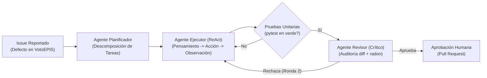

# Lienzo de Diseño de Sistemas Agénticos — VotoEPIS (Lab 10)

**Proyecto:** VotoEPIS (Sistema de Elección Digital de Delegados EPIS-UNSA)  
**Semestre:** 2026-B  
**Módulo:** Mantenimiento y Resolución Automatizada de Defectos mediante Agentes de Software  
**Autores:** Equipo de Desarrollo VotoEPIS  

---

## 1. Las 7 Decisiones de Diseño del Sistema Agéntico

### Decisión 1: ¿Agente o Flujo de Trabajo (Workflow)?
- **Selección:** **Agente Autónomo Basado en Objetivos** para tareas de diagnóstico, depuración y corrección de código fuente ante defectos reportados (issues).
- **Justificación:** La corrección de errores en un monolito modular con restricciones estrictas de integridad y seguridad electoral (ADR-001, ADR-002) no puede predecirse mediante una secuencia rígida de pasos fijos `if-else`. Cada defecto presenta síntomas variados, requiere inspeccionar diferentes módulos (`padron`, `votacion`, `compartido`), formular hipótesis dinámicas, ejecutar pruebas unitarias y autocorregirse iterativamente ante fallos.
- **Caso concreto de VotoEPIS donde un Flujo de Trabajo Fijo (Workflow) es superior:**  
  *La validación estructural y carga del Padrón Electoral (`padron.csv`)*.  
  Este proceso es un flujo determinista:  
  1) Lectura de archivo CSV con codificación UTF-8,  
  2) Validación sintáctica de columnas obligatorias (`dni`, `correo_institucional`, `escuela_profesional`),  
  3) Verificación de unicidad mediante expresiones regulares y reglas de negocio,  
  4) Cálculo de hash criptográfico SHA-256 del padrón para auditoría, y  
  5) Inserción transaccional atómica en PostgreSQL bajo esquema `padron`.  
  Introducir un agente LLM en este proceso añadiría latencia inaceptable, costo innecesario y el riesgo crítico de no determinismo o alucinación en datos electorales sensibles (violando QA-01 y la Ley 29733). Por tanto, la carga del padrón debe ser un **flujo de trabajo determinista**, mientras que el diagnóstico y mantenimiento de software corresponde a un **sistema agéntico**.

---

### Decisión 2: Arquetipo Arquitectónico
- **Selección:** **Planificador-Ejecutor + ReAct (Reasoning + Acting)**.
- **Estructura y Dinámica:**
  1. **Planificador (Planner):** Analiza el issue, inspecciona la estructura general del repositorio y descompone el problema en un plan de acción ordenado de 3 a 5 tareas concisas.
  2. **Ejecutor (Actor / ReAct):** Recibe el plan y ejecuta un bucle iterativo de Pensamiento (*Thought*), Acción (*Action*) y Observación (*Observation*). En cada iteración consulta herramientas específicas (lectura, búsqueda, edición, ejecución de tests) para aplicar el parche mínimo necesario.
  3. **Revisor (Critic):** Evalúa el resultado analizando el `git diff`, la suite de `pytest` y la complejidad ciclomática (`radon`), aprobando el cambio o solicitando una segunda ronda de corrección.

---

### Decisión 3: Catálogo Mínimo de Herramientas
El sistema provee herramientas en Python con interfaces estrictamente tipadas y validación de parámetros:

| Herramienta | Tipo | Descripción y Justificación en VotoEPIS |
|---|---|---|
| `listar_archivos(ruta)` | Lectura | Explora directorios permitidos dentro del repositorio. |
| `leer_archivo(ruta)` | Lectura | Inspecciona código fuente, pruebas o especificaciones. |
| `buscar(termino, ruta)` | Lectura | Búsqueda rápida de cadenas (identificadores, funciones, constantes). |
| `mapa_repo()` | Lectura (AST) | Analiza el árbol de sintaxis abstracta (`ast`) de `src/`, extrayendo clases, funciones y firmas sin saturar la ventana de contexto. |
| `anotar(texto)` | Memoria | Registra hipótesis de depuración en memoria persistente (`notas.md`). |
| `leer_notas()` | Memoria | Recupera hallazgos previos entre ciclos de razonamiento. |
| `editar_archivo(ruta, anterior, nuevo)` | Escritura | Aplica reemplazo exacto de fragmentos de código, evitando sobreescrituras descontroladas. |
| `ver_cambios()` | Control | Inspecciona el `git diff` de los parches aplicados en el sandbox. |
| `ejecutar_pruebas(ruta_test)` | Validación | Ejecuta `pytest` sobre pruebas unitarias focalizadas. |
| `ejecutar_comando(cmd)` | Ejecución | Corre herramientas autorizadas (`pytest`, `radon`) bajo lista blanca. |

---

### Decisión 4: Gestión de Memoria
- **Memoria de Corto Plazo (In-Context):** Mantiene la historia de mensajes del ciclo ReAct (`pensamiento`, `accion`, `args`, `observacion`) durante la ejecución de un solo rol.
- **Memoria de Largo Plazo / Notas Persistentes (`notas.md`):** Los agentes anotan hipótesis, funciones candidatas y causas raíz mediante `anotar()` y `leer_notas()`. Esta memoria compartida desacopla el razonamiento entre el planificador, ejecutor y revisor sin transferir trazas extensas que desborden los límites de tokens o degraden la atención del modelo.

---

### Decisión 5: Coordinación y Topología
- **Selección:** **Por Gestor (Orquestador Central)** con bucle **Actor-Crítico**.
- **Reglas de Aislamiento y Mínimo Privilegio:**
  - El **Planificador** solo tiene acceso a herramientas de lectura (`listar_archivos`, `leer_archivo`, `buscar`, `mapa_repo`).
  - El **Ejecutor** tiene acceso a herramientas de lectura, memoria, edición (`editar_archivo`) y pruebas (`ejecutar_pruebas`).
  - El **Revisor** tiene acceso a lectura, verificación de diff (`ver_cambios`) y validación estricta (`ejecutar_pruebas`). No puede editar archivos.
  - El bucle de corrección está acotado a un máximo de **2 rondas** (`MAX_RONDAS=2`) para prevenir bucles infinitos y costos no controlados.

---

### Decisión 6: Rol del Humano (Human-in-the-Loop)
- **Selección:** **Humano como Revisor y Aprobador Final (Supervisión)**.
- **Puntos de Control Humano:**
  1. El agente nunca realiza commits ni push automáticos a la rama principal (`main`).
  2. Cada propuesta de solución queda aislada en un parche o Pull Request.
  3. El humano inspecciona el reporte del revisor, el `git diff` y las métricas de complejidad antes de aceptar la integración al código base de producción.

---

### Decisión 7: Control, Seguridad y Guardrails
- **Contrato JSON Estricto:** Cada salida del LLM debe ser un objeto JSON parseable que cumpla con `Decision(pensamiento, accion, args, final)`. Las acciones desconocidas o argumentos malformados son rechazados por el validador, forzando autocorrección.
- **Sandbox de Sistema de Archivos:** Las rutas están restringidas a la raíz del repositorio (`repo_dir`). Queda bloqueado cualquier intento de escape de ruta (`..`, rutas absolutas fuera del workspace).
- **Protección de Pruebas Unitarias:** La política deniega `editar_archivo` sobre archivos dentro de `tests/` o `.git/`. El agente debe corregir el código en `src/`, nunca alterar el oráculo de prueba.
- **Guardas de Iteración:**
  - `max_pasos = 12` por ejecución del ciclo ReAct.
  - `MAX_RONDAS = 2` en el orquestador actor-crítico.
  - Si un agente supera el límite de pasos, la máquina de estados transiciona a `LimiteAlcanzado` y solicita intervención.
