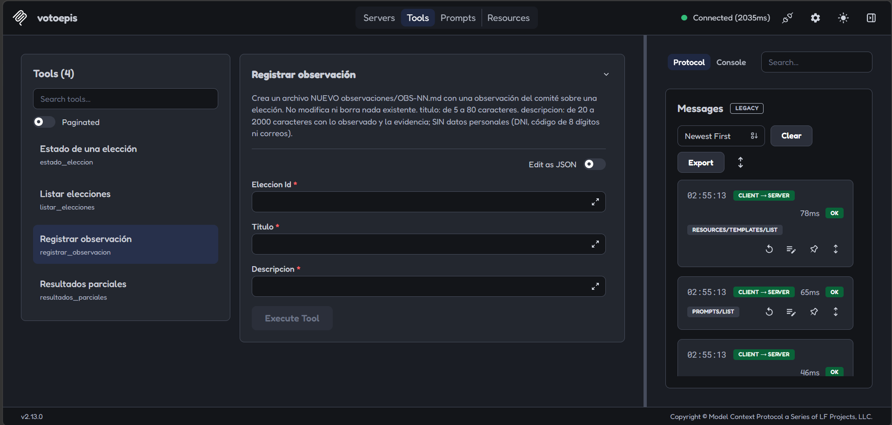
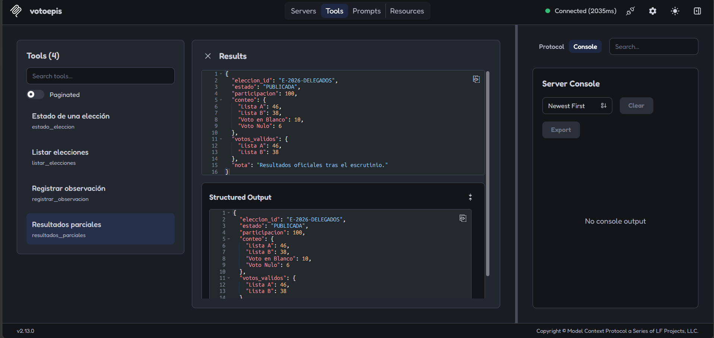
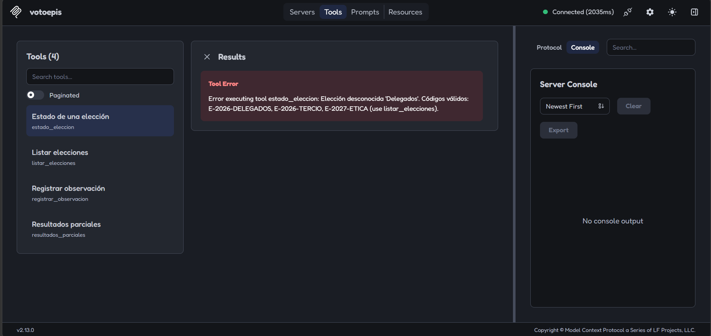

# Evidencias con MCP Inspector (Lab 11, E3)

**Comando** (desde la raíz del repositorio; requiere Node.js 18+):
```bash
npx @modelcontextprotocol/inspector python agentes/mcp/servidor_mcp/votoepis_mcp.py
```
Se abre el navegador. En *Transport Type* debe decir **STDIO**, el comando `python` y el argumento `agentes/mcp/servidor_mcp/votoepis_mcp.py`. Luego se pulsa **Connect**.

> Versión usada: MCP Inspector **2.13.0**. Las capturas van en `agentes/mcp/pruebas/img/`.

## Captura 1: catálogo (pestaña *Tools* → *List Tools*)


**Qué se ve:** las 4 herramientas en el orden del catálogo (`listar_elecciones`, `estado_eleccion`, `resultados_parciales`, `registrar_observacion`), cada una con su descripción y su `inputSchema`.

**Comentario:**
- Las descripciones se entienden sin leer el código: dicen el formato del código de elección (`E-2026-DELEGADOS`), los límites del título y la descripción, y que antes del escrutinio no hay conteo.
- Solo `registrar_observacion` tiene `readOnlyHint: false`. Las otras tres están marcadas como solo lectura.
- Las tres consultas publican un `outputSchema`, generado desde sus tipos `TypedDict`.

## Captura 2: llamada correcta (`resultados_parciales` con `E-2026-DELEGADOS`)


**Qué se ve:** `structuredContent` con `estado: PUBLICADA`, `participacion: 100`, `conteo` (Lista A 46, Lista B 38, Blanco 10, Nulo 6) y `votos_validos` (solo Lista A y Lista B), con `isError: false`.

**Comentario:** el servidor no recalcula nada. Usa `conteo()` y `computar_votos_validos()` del dominio, así que los blancos y nulos quedan fuera de los votos válidos (ISSUE-02). Si se repite con `E-2026-TERCIO` (ABIERTA), `conteo` y `votos_validos` llegan en `null`: el servidor no revela resultados antes del escrutinio (ADR-002).

## Captura 3: llamada con error (`estado_eleccion` con `Delegados`)


**Qué se ve:** `isError: true` y el texto «Elección desconocida 'Delegados'. Códigos válidos: E-2026-DELEGADOS, E-2026-TERCIO, E-2027-ETICA (use listar_elecciones)».

**Comentario:** es un **error de negocio** (`ToolError`), no un error de protocolo. Viaja como resultado y el modelo lo puede leer y corregir en el siguiente paso, porque el mensaje trae los valores válidos.

## Verificación extra: recurso plantilla (pestaña *Resources* → *Resource Templates*)
- `votoepis://adr/002` → devuelve el ADR-002.
- `votoepis://adr/../../secretos` → **error de protocolo** (`Unknown resource`). La ruta no coincide con la plantilla y el SDK además rechaza el recorrido de directorios.
- `votoepis://adr/2` → error «Use un número de 3 dígitos».

## Verificación sin interfaz (modo CLI del Inspector)
Mismas comprobaciones desde la terminal, útil si el navegador no abre:
```bash
npx @modelcontextprotocol/inspector --cli python agentes/mcp/servidor_mcp/votoepis_mcp.py --method tools/list
npx @modelcontextprotocol/inspector --cli python agentes/mcp/servidor_mcp/votoepis_mcp.py --method tools/call --tool-name estado_eleccion --tool-arg eleccion_id=Delegados
npx @modelcontextprotocol/inspector --cli python agentes/mcp/servidor_mcp/votoepis_mcp.py --method resources/read --uri "votoepis://adr/../../secretos"
```
