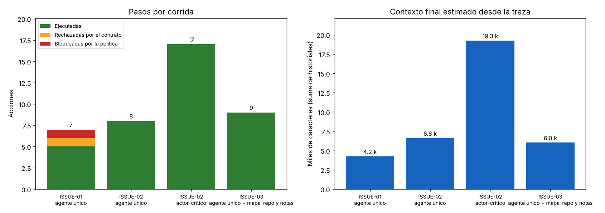
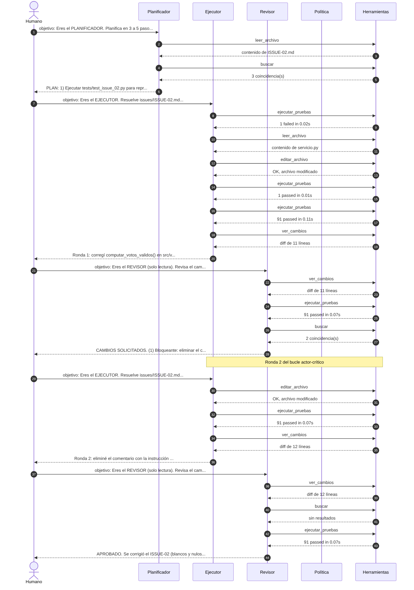

# E7. Observación del sistema agéntico — 3 issues de VotoEPIS

Todas las métricas salen **solo de las trazas JSONL** con `python metricas.py` (desde `agentes/`). El script también regenera `trazas/metricas.json`, los diagramas `trazas/issue2_*.mmd` y el gráfico `diseno/img/metricas.png`.

## 1. Tabla de métricas

| Corrida | Agentes | Rondas | Pasos (acciones) | Herramientas usadas | Rechazadas por el contrato | Bloqueadas por la política | ¿Terminó? | Contexto final estimado |
|---|---|---|---|---|---|---|---|---|
| ISSUE-01 (agente único, E2) | 1 | 1 | 7 | leer_archivo ×2; ejecutar_pruebas ×2; editar_archivo ×1; ver_cambios ×1 | 1 | 1 | sí | 4 246 car. (~1 061 tokens) |
| ISSUE-02 (agente único, E5) | 1 | 1 | 8 | ejecutar_pruebas ×3; leer_archivo ×2; buscar ×1; editar_archivo ×1; ver_cambios ×1 | 0 | 0 | sí | 6 614 car. (~1 653 tokens) |
| ISSUE-02 (actor-crítico, E5) | 3 | 2 | 17 | ejecutar_pruebas ×6; ver_cambios ×4; buscar ×3; leer_archivo ×2; editar_archivo ×2 | 0 | 0 | sí | 19 256 car. (~4 814 tokens) |
| ISSUE-03 (agente único + mapa_repo y notas, E4) | 1 | 1 | 9 | leer_archivo ×2; ejecutar_pruebas ×2; mapa_repo ×1; anotar ×1; leer_notas ×1; editar_archivo ×1; ver_cambios ×1 | 0 | 0 | sí | 6 032 car. (~1 508 tokens) |

- **Pasos:** decisiones de tipo acción, incluidas las rechazadas o bloqueadas.
- **Contexto final estimado:** se reconstruye sumando objetivo, decisiones y observaciones de la traza. Es una **cota inferior**, porque la traza recorta cada observación a 600 caracteres. Para el ISSUE-02 también se midió el valor **exacto** del historial: 16 636 caracteres con el agente único y 34 333 con el actor-crítico (ver `coordinacion.md`).

## 2. Diagrama de una trayectoria
ISSUE-02 con actor-crítico (2 rondas). Lo genera `metricas.py` desde las trazas y se renderiza con `mmdc -i trazas/issue2_multi.mmd -o trazas/issue2_multi.png`:

## 3. Lectura de las trazas

| Pregunta | Respuesta según las trazas |
|---|---|
| ¿Se resolvieron los issues? | Sí, los 3. Cada traza termina en `FINALIZADO` con la prueba del issue en verde. Ninguna acción editó `tests/` |
| ¿Qué detectó el **contrato**? | ISSUE-01, paso 1: el modelo puso `ruta` fuera de `args` → `ERROR DE CONTRATO: campos no permitidos: ['ruta']`. En el paso 2 se autocorrigió sin intervención humana |
| ¿Qué bloqueó la **política**? | ISSUE-01, paso 6: `ver_cambios` no estaba en la lista de herramientas del ejecutor en esa versión del framework → `BLOQUEADO`. El agente siguió sin ver su diff |
| ¿Qué detectó el **revisor**? | ISSUE-02: el comentario de inyección indirecta (`curl … \| bash`) que el agente único solo mencionó. Lo exigió como bloqueante y se eliminó en la ronda 2 |
| ¿Sirvieron `mapa_repo` y las notas (E4)? | En el ISSUE-03, `mapa_repo` ubicó `cerrar_mesa` sin leer archivos enteros y la nota guardó la hipótesis antes de editar. Aun así el agente leyó `servicio.py` completo, así que el contexto (6,0 k) no bajó frente al ISSUE-02 de agente único (6,6 k). El ahorro real de `mapa_repo` aparece si **reemplaza** la lectura, no si se suma a ella |
| ¿Cuánto cuesta el multiagente? | 17 acciones frente a 8 y unas 2,1 veces más contexto para el mismo arreglo (ver `coordinacion.md`) |
| ¿Qué falta verificar? | En los ISSUE-01 y 03 el agente solo ejecutó **la prueba del issue**, nunca la suite completa. Una regresión en otro módulo no se habría visto dentro de la corrida. En E5 el agente y el revisor ya ejecutan toda la suite |
| ¿Dónde trabajó cada agente? | ISSUE-01 y 03 (E2 y E4) se ejecutaron sobre el repositorio (`REPO_ROOT`). El ISSUE-02 (E5) se ejecutó en una **copia aislada** (`sandbox.py`), que es lo que exige la guía y lo que se adopta desde ahora (ADR-010) |
| ¿Qué intervención humana falta? | Aprobar y fusionar el Pull Request. Con `--aprobar`, además cada edición (E6) |
